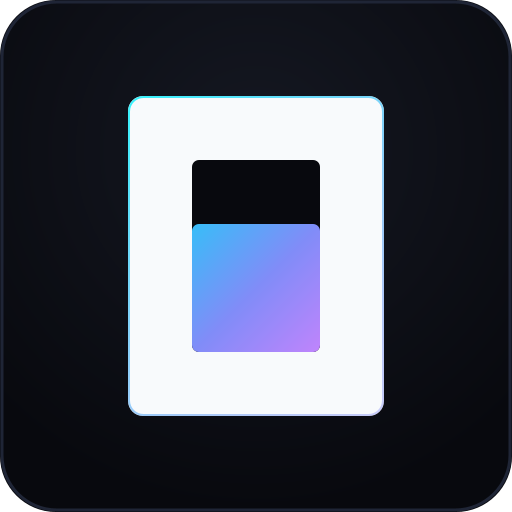
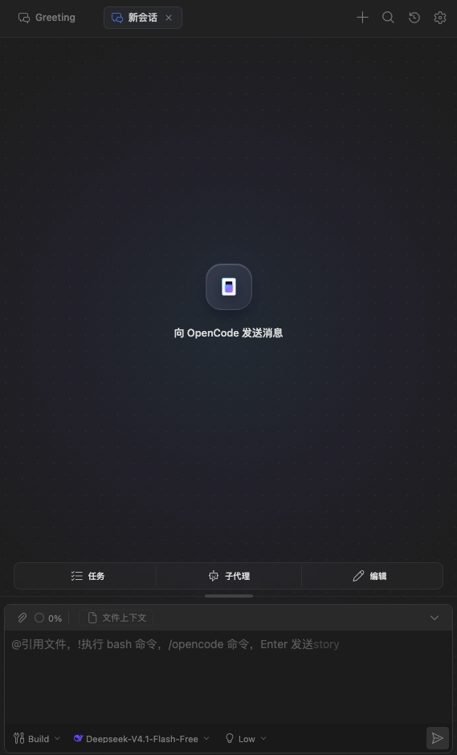
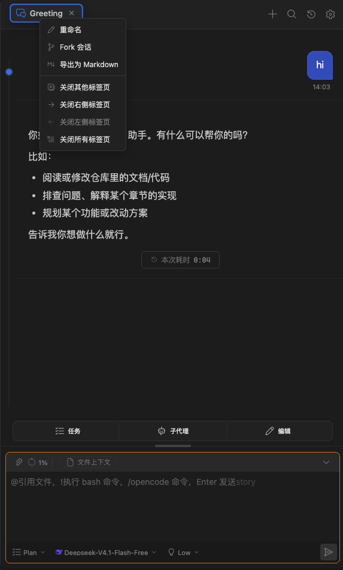
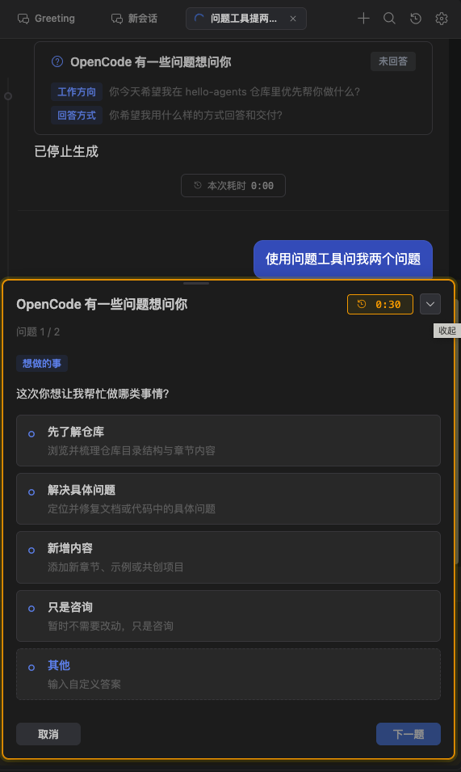
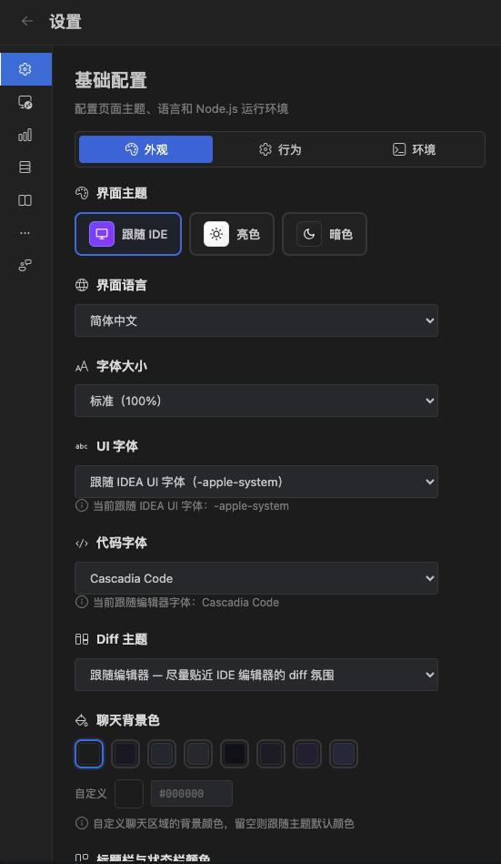

<a id="readme-top"></a>

<div align="center">



# OpenCode Buddy for VS Code

<p align="center">
  <strong>Native, Full-Featured Chat GUI &amp; Workflow Assistant for OpenCode in Visual Studio Code</strong>
</p>

[](https://marketplace.visualstudio.com/items?itemName=senjuobito.opencode-buddy)
[](https://marketplace.visualstudio.com/items?itemName=senjuobito.opencode-buddy)
[](https://opensource.org/licenses/MIT)
[](https://github.com/SenjuObito/opencode-vscode-plugin/pulls)

<p align="center">
  <a href="README.md">English</a> •
  <a href="README.zh-CN.md">简体中文</a>
</p>

<p align="center">
  <a href="#-about-the-project">About The Project</a> •
  <a href="#-key-features">Key Features</a> •
  <a href="#-quick-start">Quick Start</a> •
  <a href="#-usage-guide">Usage Guide</a> •
  <a href="#-development">Development</a> •
  <a href="#-contributing">Contributing</a> •
  <a href="#-license--acknowledgments">License</a> •
  <a href="#-support-the-project">Support</a>
</p>

</div>

---

<details>
  <summary>Table of Contents</summary>
  <ol>
    <li><a href="#-about-the-project">About The Project</a></li>
    <li><a href="#-key-features">Key Features</a></li>
    <li>
      <a href="#-quick-start">Quick Start</a>
      <ul>
        <li><a href="#prerequisites">Prerequisites</a></li>
        <li><a href="#installation">Installation</a></li>
      </ul>
    </li>
    <li>
      <a href="#-usage-guide">Usage Guide</a>
      <ul>
        <li><a href="#1-opening-the-chat-panel">1. Opening the Chat Panel</a></li>
        <li><a href="#2-interaction--commands">2. Interaction &amp; Commands</a></li>
        <li><a href="#3-settings--customization">3. Settings &amp; Customization</a></li>
      </ul>
    </li>
    <li><a href="#-development">Development</a></li>
    <li><a href="#-contributing">Contributing</a></li>
    <li><a href="#-license--acknowledgments">License &amp; Acknowledgments</a></li>
    <li><a href="#-support-the-project">Support the Project</a></li>
  </ol>
</details>

---

## 🌟 About The Project

<div align="center">

<table>
  <tr>
    <td width="33%" align="center" valign="top">
      
      <br />
      <sub><b>New Session</b></sub><br />
      <sub>Clean empty state with quick input</sub>
    </td>
    <td width="33%" align="center" valign="top">
      
      <br />
      <sub><b>Multi-Tab Sessions</b></sub><br />
      <sub>Rename, fork, export and bulk close</sub>
    </td>
    <td width="33%" align="center" valign="top">
      
      <br />
      <sub><b>Interactive Questions</b></sub><br />
      <sub>Multi-step questions and option choices</sub>
    </td>
  </tr>
</table>

</div>

Many developers want to use **OpenCode**'s autonomous coding power seamlessly inside VS Code, but the command-line workflow keeps interrupting their train of thought, while some multi-model tools are over-wrapped and cold-start a new process for every message.

**OpenCode Buddy** is a high-performance visual plugin built exclusively for OpenCode:

- **Persistent daemon architecture** — no more "one process per message". A built-in long-lived `opencode serve` daemon supports connection reuse, automatic warm-up and self-healing recovery.
- **Native, immersive interaction** — fits seamlessly into the VS Code sidebar (activity bar), the secondary sidebar and editor splits.
- **Full capability parity** — complete support for collapsible streaming thinking, step-by-step diff review with one-click rollback, dynamic model and reasoning-depth selection, plus MCP marketplace and Skills extensions.

---

## 🚀 Key Features

* ⚡ **Persistent Daemon** — keeps a long-lived background service via `@opencode-ai/sdk` (default port `4096`, overridable by environment variable), with heartbeat keep-alive and state isolation, so responses never pay a cold-start penalty.
* 🌊 **Fully streaming sessions and thinking chain** — real-time typewriter output, collapsible interactive thinking deltas and a syntax-highlighted code diff view.
* 🗂️ **Multi-tab sessions and multi-panel layout** — switch freely between the sidebar, the secondary sidebar and editor splits; each tab keeps its own context and can be floated and renamed.
* 📎 **Rich context and quick input**:
  * Fuzzy `@` search to reference workspace files and symbols;
  * Drag-and-drop and clipboard paste for direct multimodal image input;
  * Native support for OpenCode slash commands (`/init`, `/review`, `/compact`) and `!shell` quick terminal commands.
* 🛡️ **Interactive permissions and questions** — fine-grained control over tool calls and file changes (allow once, always allow, deny), with native forms for questionnaires and plan confirmation.
* ⏪ **Session time machine and one-click rollback** — instant search of local session history, branching with fork, rewind to an earlier turn and full export as Markdown.
* 🧩 **MCP marketplace and Skills governance** — visualize MCP server status and install/configure servers from the marketplace in one click; auto-discover and directly edit workspace and global skills.
* 🎨 **Deep customization** — adapts perfectly to VS Code light and dark themes, with customizable fonts, font size, chat background color and interface language.

---

## ⚡ Quick Start

### Prerequisites

1. **OpenCode CLI** — make sure `opencode` is installed and executable on your `PATH`.
2. **Node.js** — `>= 18.0.0`.

### Installation

* **Option 1 (recommended)** — search for `OpenCode Buddy` in the VS Code Marketplace and click Install.
* **Option 2 (VSIX)** — download the latest `.vsix` from [Releases](https://github.com/SenjuObito/opencode-vscode-plugin/releases) and run `Extensions: Install from VSIX...` in VS Code.

---

## 💡 Usage Guide

### 1. Opening the Chat Panel

Once installed, open the panel in any of the following ways:

* Click the **OpenCode icon** in the VS Code activity bar;
* Click the shortcut in the editor title bar (top right);
* Open the Command Palette (`Ctrl+Shift+P` / `Cmd+Shift+P`) and run:
  * `Open OpenCode Buddy Panel (Left)`
  * `New OpenCode Buddy Chat` — opens an independent parallel session in an editor split.

### 2. Interaction & Commands

- **Mode switching** — the bottom toolbar toggles between `Build` (execute and edit) and `Plan` (design and plan) in one click;
- **Models and reasoning depth** — every provider and model configured in your local OpenCode is synced in real time, and thinking depth can be adjusted on the fly (`low` / `medium` / `high`);
- **Files and context references** — type `@` in the input box to open the workspace file picker; images can also be dragged straight into the input box.

### 3. Settings & Customization

Click the ⚙️ gear icon in the top-right corner of the panel to open the settings center:

<div align="center">
  
</div>

* **Appearance and fonts** — follow the IDE theme or pick your own, and freely set the interface font and the monospace code font;
* **Environment and paths** — configure or verify the Node.js and `opencode` executable paths;
* **MCP marketplace and Skills** — manage MCP tool extensions and capability packs visually.

---

## 🛠️ Development

This project uses **pnpm** to manage dependencies uniformly:

```bash
# 1. Clone the repository
git clone https://github.com/SenjuObito/opencode-vscode-plugin.git
cd opencode-vscode-plugin

# 2. Install dependencies for the root and all sub-modules
pnpm install
cd webview && pnpm install && cd ..

# 3. Build the extension host and the webview
pnpm run compile
cd webview && pnpm run build && cd ..

# 4. Press F5 in VS Code to start the Extension Development Host for debugging
```

---

## 🤝 Contributing

Contributions are what make the open source community such an amazing place to learn, inspire and create.

1. Fork the Project
2. Create your Feature Branch (`git checkout -b feature/AmazingFeature`)
3. Commit your Changes (`git commit -m 'feat: Add some AmazingFeature'`)
4. Push to the Branch (`git push origin feature/AmazingFeature`)
5. Open a Pull Request

---

## 📄 License & Acknowledgments

- **License** — released under the **MIT License**. See [`LICENSE`](./LICENSE) for details.
- **Upstream & inspirations** — thanks to [`jetbrains-cc-gui`](https://github.com/zhukunpenglinyutong/jetbrains-cc-gui) for the excellent UI architecture that inspired this project.
- **Other languages** — [简体中文](./README.zh-CN.md)

---

## 💖 Support the Project

If OpenCode Buddy saves you time, you can buy the author a coffee — a Gemini Pro plan and DeepSeek API usage (about 120 CNY) funded this project, and sponsorship helps cover that cost.

| WeChat Pay | Alipay | PayPal |
|:---:|:---:|:---:|
|  |  |  |

Every sponsor is added to the [sponsors list](./SPONSORS.md), no matter the amount. Thank you for your support!

<p align="right">(<a href="#readme-top">back to top ↑</a>)</p>
