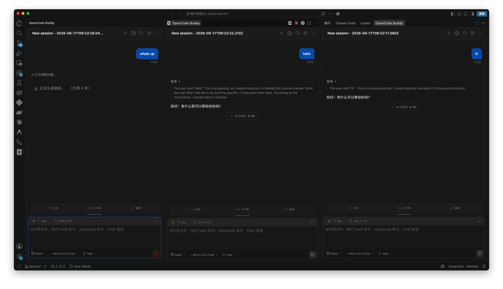
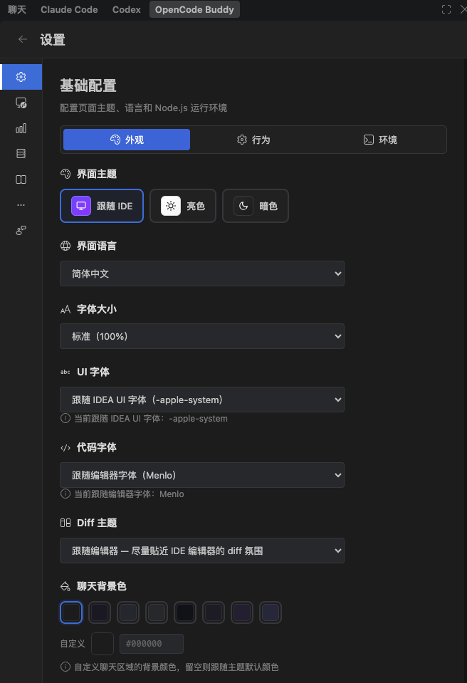

<a id="readme-top"></a>

<div align="center">


# OpenCode Buddy for VS Code

<p align="center">
  <strong>Native, Full-Featured Chat GUI & Workflow Assistant for OpenCode in Visual Studio Code</strong>
  <br />
  <span>在 VS Code 中体验丝滑、原生的 OpenCode 全功能可视化交互与智能编码伴侣</span>
</p>

[](https://marketplace.visualstudio.com/items?itemName=senjuobito.opencode-buddy)
[](https://marketplace.visualstudio.com/items?itemName=senjuobito.opencode-buddy)
[](https://opensource.org/licenses/MIT)
[](https://github.com/SenjuObito/opencode-vscode-plugin/pulls)

<p align="center">
  <a href="#-about-the-project">About The Project</a> •
  <a href="#-key-features">Key Features</a> •
  <a href="#-quick-start">Quick Start</a> •
  <a href="#-usage-guide">Usage Guide</a> •
  <a href="#-development">Development</a> •
  <a href="#-contributing">Contributing</a> •
  <a href="#-license">License</a>
</p>

</div>

---

<details>
  <summary>Table of Contents / 目录导航</summary>
  <ol>
    <li><a href="#-about-the-project">About The Project</a></li>
    <li><a href="#-key-features">Key Features</a></li>
    <li>
      <a href="#-quick-start">Quick Start</a>
      <ul>
        <li><a href="#prerequisites">Prerequisites</a></li>
        <li><a href="#installation">Installation</a></li>
      </ul>
    </li>
    <li>
      <a href="#-usage-guide">Usage Guide</a>
      <ul>
        <li><a href="#1-opening-the-chat-panel">1. Opening the Chat Panel</a></li>
        <li><a href="#2-interaction--commands">2. Interaction & Commands</a></li>
        <li><a href="#3-settings--customization">3. Settings & Customization</a></li>
      </ul>
    </li>
    <li><a href="#-development">Development</a></li>
    <li><a href="#-contributing">Contributing</a></li>
    <li><a href="#-license--acknowledgments">License & Acknowledgments</a></li>
  </ol>
</details>

---

## 🌟 About The Project

<div align="center">
  
</div>

许多开发者渴望在 VS Code 内部无缝使用 **OpenCode** 强大的自主编码能力，但现有的命令行交互频繁打断编码思路，而部分多模型工具又存在封装过重、进程反复冷启动等问题。

**OpenCode Buddy** 是专为 OpenCode 打造的高性能可视化插件：
- **常驻 Daemon 架构**：告别“每发一条消息新启动一次进程”的卡顿。内置持久化 `opencode serve` 守护进程，支持连接复用、自动预热与故障自愈；
- **原生沉浸交互**：无缝融入 VS Code 侧边栏（活动栏）、右侧副侧边栏及编辑器分屏；
- **全能力对齐**：完整支持流式思考过程折叠、分步 Diff 审阅一键回滚、动态模型与推理深度选择、MCP 市场与 Skills 扩展。

---

## 🚀 Key Features

* ⚡ **常驻守护进程（Persistent Daemon）**：通过 `@opencode-ai/sdk` 维持常驻后台服务（默认端口 4096，支持环境变量覆盖），心跳保活与状态隔离，响应零冷启动延迟。
* 🌊 **全流式会话与思考链**：实时流式打字输出、可交互的思考过程（Thinking Delta）折叠展开、带语法高亮的代码 Diff 视图。
* 🗂️ **多标签会话与多面板布局**：在侧边栏、副侧边栏或主编辑器分屏任意切换，标签页独立上下文，支持浮动与重命名。
* 📎 **富上下文引用与快捷输入**：
  * 支持 `@` 键模糊搜索引入项目文件及符号；
  * 图片拖拽及剪贴板粘贴直接多模态输入；
  * 原生支持 OpenCode 斜杠命令（`/init`、`/review`、`/compact`）与 `!shell` 快捷终端命令。
* 🛡️ **交互式权限审批与问答**：工具调用与文件改动权限精细管控（允许单次、始终允许、拒绝），问卷表单与计划确认原生弹窗交互。
* ⏪ **历史时光机与一键回退**：本地会话历史秒级检索，支持分支衍生（Fork）、轮次重卷（Rewind）与 Markdown 格式全量导出。
* 🧩 **MCP 市场与 Skills 治理**：可视化查看 MCP 服务状态，一键从市场安装与配置；工作区与全局 Skills 自动发现与直接编辑。
* 🎨 **深度个性化定制**：完美适配 VS Code 浅色/深色主题，支持自定义字体、字号、聊天背景色与多语言界面切换。

---

## ⚡ Quick Start

### Prerequisites
1. **OpenCode CLI**：确保系统中已安装 `opencode` 并在环境变量 `PATH` 中可执行。
2. **Node.js**：>= 18.0.0。

### Installation
* **方法 1（推荐）**：在 VS Code 扩展市场搜索 `OpenCode Buddy` 并点击安装。
* **方法 2（VSIX 安装）**：在 [Releases](https://github.com/SenjuObito/opencode-vscode-plugin/releases) 下载最新 `.vsix` 文件，在 VS Code 中执行 `Extensions: Install from VSIX...`。

---

## 💡 Usage Guide

### 1. Opening the Chat Panel
安装完成后，可通过以下任意方式呼出对话面板：
* 点击 VS Code 左侧活动栏中的 **OpenCode 图标**；
* 点击编辑器右上角标题栏的快捷入口；
* 呼出命令面板（`Ctrl+Shift+P` / `Cmd+Shift+P`），输入并运行：
  * `Open OpenCode Buddy Panel (Left)`
  * `New OpenCode Buddy Chat`（在编辑器分屏中打开独立的并行会话）

### 2. Interaction & Commands
- **模式切换**：底部工具栏可一键切换 `Build`（构建执行）与 `Plan`（计划设计）模式；
- **模型与推理深度**：实时同步本地 OpenCode 配置的所有 Provider 与模型，可动态调节思考深度（`low` / `medium` / `high`）；
- **文件与上下文引用**：在输入框输入 `@` 即可唤出工程文件选择器；支持将图片直接拖拽至输入框。

### 3. Settings & Customization
点击面板右上角的 ⚙️ 齿轮图标进入设置中心：

<div align="center">
  
</div>

* **外观与字体**：跟随 IDE 主题或自定义主题，自由设置界面字体与等宽代码字体；
* **环境与路径**：配置或校验 Node.js 与 `opencode` 可执行文件路径；
* **MCP 市场与 Skills**：可视化管理 MCP 工具扩展与能力包。

---

## 🛠️ Development

本项目采用 **pnpm** 统一管理依赖：

```bash
# 1. 克隆仓库
git clone https://github.com/SenjuObito/opencode-vscode-plugin.git
cd opencode-vscode-plugin

# 2. 安装根目录及子模块依赖
pnpm install
cd webview && pnpm install && cd ..

# 3. 编译扩展宿主与 Webview
pnpm run compile
cd webview && pnpm run build && cd ..

# 4. 在 VS Code 中按 F5 启动 Extension Development Host 调试
```

---

## 🤝 Contributing

Contributions are what make the open source community such an amazing place to learn, inspire, and create.
1. Fork the Project
2. Create your Feature Branch (`git checkout -b feature/AmazingFeature`)
3. Commit your Changes (`git commit -m 'feat: Add some AmazingFeature'`)
4. Push to the Branch (`git push origin feature/AmazingFeature`)
5. Open a Pull Request

---

## 📄 License & Acknowledgments

- **License**：本项目基于 **MIT License** 开源。详情见 [`LICENSE`](./LICENSE)。
- **Upstream & Inspirations**：感谢 [`jetbrains-cc-gui`](https://github.com/zhukunpenglinyutong/jetbrains-cc-gui) 项目提供的优秀界面架构灵感。

<p align="right">(<a href="#readme-top">back to top ↑</a>)</p>
