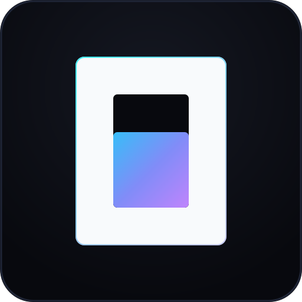
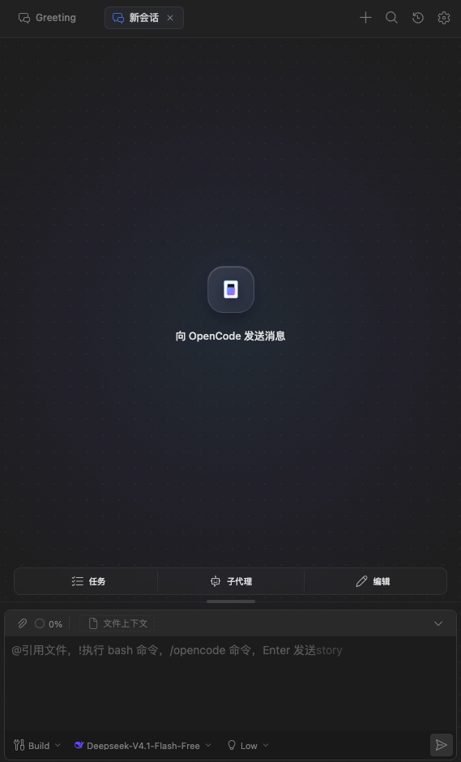
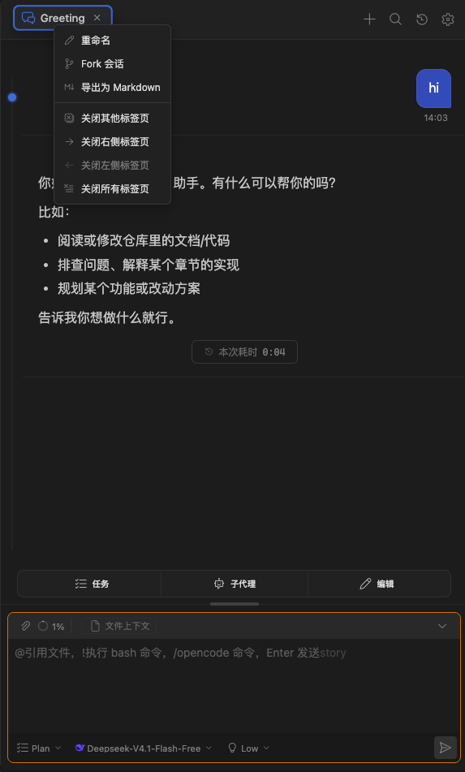
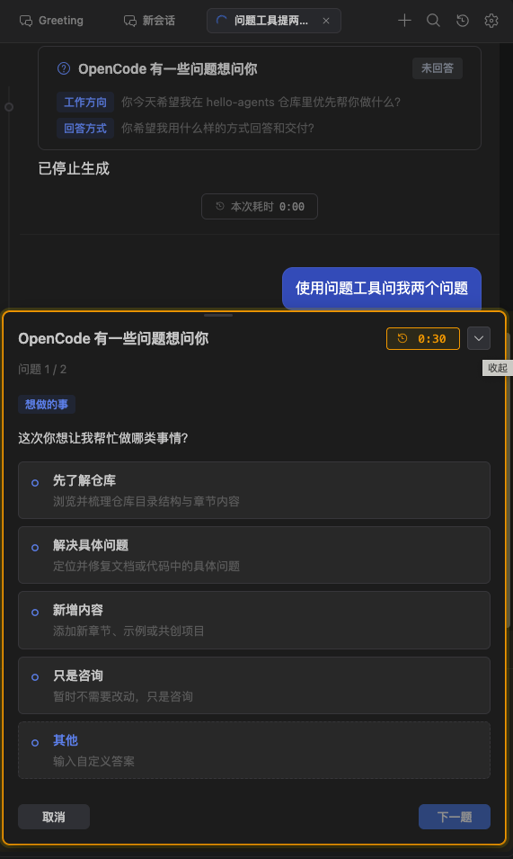
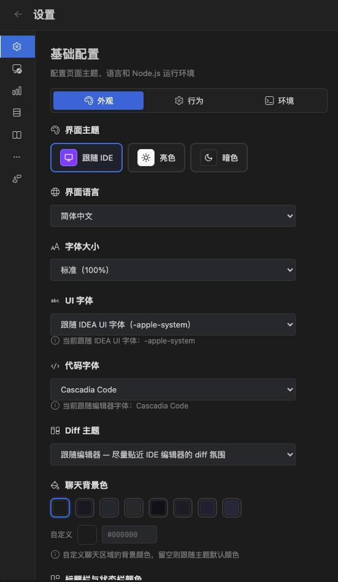

<a id="readme-top"></a>

<div align="center">



# OpenCode Buddy for VS Code

<p align="center">
  <strong>在 VS Code 中体验原生、全功能的 OpenCode 聊天 GUI 与智能编码工作流助手</strong>
</p>

[](https://marketplace.visualstudio.com/items?itemName=senjuobito.opencode-buddy)
[](https://marketplace.visualstudio.com/items?itemName=senjuobito.opencode-buddy)
[](https://opensource.org/licenses/MIT)
[](https://github.com/SenjuObito/opencode-vscode-plugin/pulls)

<p align="center">
  <a href="README.md">English</a> •
  <a href="README.zh-CN.md">简体中文</a>
</p>

<p align="center">
  <a href="#-关于项目">关于项目</a> •
  <a href="#-核心特性">核心特性</a> •
  <a href="#-快速开始">快速开始</a> •
  <a href="#-使用指南">使用指南</a> •
  <a href="#-开发">开发</a> •
  <a href="#-参与贡献">参与贡献</a> •
  <a href="#-许可证与致谢">许可证</a> •
  <a href="#-赞助支持">赞助</a>
</p>

</div>

---

<details>
  <summary>目录导航</summary>
  <ol>
    <li><a href="#-关于项目">关于项目</a></li>
    <li><a href="#-核心特性">核心特性</a></li>
    <li>
      <a href="#-快速开始">快速开始</a>
      <ul>
        <li><a href="#前置条件">前置条件</a></li>
        <li><a href="#安装">安装</a></li>
      </ul>
    </li>
    <li>
      <a href="#-使用指南">使用指南</a>
      <ul>
        <li><a href="#1-打开聊天面板">1. 打开聊天面板</a></li>
        <li><a href="#2-交互与命令">2. 交互与命令</a></li>
        <li><a href="#3-设置与个性化">3. 设置与个性化</a></li>
      </ul>
    </li>
    <li><a href="#-开发">开发</a></li>
    <li><a href="#-参与贡献">参与贡献</a></li>
    <li><a href="#-许可证与致谢">许可证与致谢</a></li>
    <li><a href="#-赞助支持">赞助支持</a></li>
  </ol>
</details>

---

## 🌟 关于项目

<div align="center">

<table>
  <tr>
    <td width="33%" align="center" valign="top">
      
      <br />
      <sub><b>新会话</b></sub><br />
      <sub>清爽的空状态与快捷输入</sub>
    </td>
    <td width="33%" align="center" valign="top">
      
      <br />
      <sub><b>多标签会话</b></sub><br />
      <sub>重命名、Fork、导出与批量关闭</sub>
    </td>
    <td width="33%" align="center" valign="top">
      
      <br />
      <sub><b>交互式问答</b></sub><br />
      <sub>多步骤问答与选项选择</sub>
    </td>
  </tr>
</table>

</div>

许多开发者渴望在 VS Code 内部无缝使用 **OpenCode** 强大的自主编码能力，但命令行交互频繁打断编码思路，而部分多模型工具又存在封装过重、每发一条消息都冷启动一次进程的问题。

**OpenCode Buddy** 是专为 OpenCode 打造的高性能可视化插件：

- **常驻守护进程架构** —— 告别"每发一条消息就启动一个进程"。内置长驻的 `opencode serve` 守护进程，支持连接复用、自动预热与故障自愈。
- **原生沉浸式交互** —— 无缝融入 VS Code 侧边栏（活动栏）、右侧副侧边栏及编辑器分屏。
- **全能力对齐** —— 完整支持流式思考过程折叠、分步 Diff 审阅与一键回滚、动态模型与推理深度选择，以及 MCP 市场与 Skills 扩展。

---

## 🚀 核心特性

* ⚡ **常驻守护进程** —— 通过 `@opencode-ai/sdk` 维持长驻后台服务（默认端口 `4096`，支持环境变量覆盖），心跳保活与状态隔离，响应没有冷启动延迟。
* 🌊 **全流式会话与思考链** —— 实时打字机输出、可折叠且可交互的思考过程（Thinking Delta），以及带语法高亮的代码 Diff 视图。
* 🗂️ **多标签会话与多面板布局** —— 在侧边栏、副侧边栏或主编辑器分屏之间任意切换；每个标签页拥有独立上下文，并支持浮动与重命名。
* 📎 **丰富的上下文与快捷输入**：
  * `@` 模糊搜索引用工作区文件与符号；
  * 图片拖拽与剪贴板粘贴，直接进行多模态输入；
  * 原生支持 OpenCode 斜杠命令（`/init`、`/review`、`/compact`）与 `!shell` 快捷终端命令。
* 🛡️ **交互式权限审批与问答** —— 对工具调用与文件改动做细粒度管控（允许单次、始终允许、拒绝），并提供问卷表单与计划确认的原生交互。
* ⏪ **历史时光机与一键回退** —— 本地会话历史秒级检索，支持分支衍生（Fork）、轮次回溯（Rewind）与 Markdown 全量导出。
* 🧩 **MCP 市场与 Skills 治理** —— 可视化查看 MCP 服务状态，从市场一键安装与配置；自动发现并直接编辑工作区与全局 Skills。
* 🎨 **深度个性化定制** —— 完美适配 VS Code 浅色与深色主题，支持自定义字体、字号、聊天背景色与界面语言切换。

---

## ⚡ 快速开始

### 前置条件

1. **OpenCode CLI** —— 确保系统中已安装 `opencode` 并可在 `PATH` 中执行。
2. **Node.js** —— `>= 18.0.0`。

### 安装

* **方式 1（推荐）** —— 在 VS Code 扩展市场搜索 `OpenCode Buddy` 并点击安装。
* **方式 2（VSIX）** —— 从 [Releases](https://github.com/SenjuObito/opencode-vscode-plugin/releases) 下载最新的 `.vsix`，然后在 VS Code 中执行 `Extensions: Install from VSIX...`。

---

## 💡 使用指南

### 1. 打开聊天面板

安装完成后，可通过以下任意方式打开面板：

* 点击 VS Code 左侧活动栏中的 **OpenCode 图标**；
* 点击编辑器标题栏右上角的快捷入口；
* 打开命令面板（`Ctrl+Shift+P` / `Cmd+Shift+P`），运行：
  * `Open OpenCode Buddy Panel (Left)`
  * `New OpenCode Buddy Chat` —— 在编辑器分屏中打开一个独立的并行会话。

### 2. 交互与命令

- **模式切换** —— 底部工具栏可一键在 `Build`（执行与修改）和 `Plan`（设计与规划）之间切换；
- **模型与推理深度** —— 实时同步本地 OpenCode 中配置的所有 Provider 与模型，并可随时调节思考深度（`low` / `medium` / `high`）；
- **文件与上下文引用** —— 在输入框输入 `@` 即可唤起工作区文件选择器；也可以直接将图片拖入输入框。

### 3. 设置与个性化

点击面板右上角的 ⚙️ 齿轮图标打开设置中心：

<div align="center">
  
</div>

* **外观与字体** —— 跟随 IDE 主题或自定义主题，自由设置界面字体与等宽代码字体；
* **环境与路径** —— 配置或校验 Node.js 与 `opencode` 可执行文件路径；
* **MCP 市场与 Skills** —— 可视化管理 MCP 工具扩展与能力包。

---

## 🛠️ 开发

本项目使用 **pnpm** 统一管理依赖：

```bash
# 1. 克隆仓库
git clone https://github.com/SenjuObito/opencode-vscode-plugin.git
cd opencode-vscode-plugin

# 2. 安装根目录及子模块依赖
pnpm install
cd webview && pnpm install && cd ..

# 3. 编译扩展宿主与 Webview
pnpm run compile
cd webview && pnpm run build && cd ..

# 4. 在 VS Code 中按 F5 启动 Extension Development Host 调试
```

---

## 🤝 参与贡献

开源社区正是因为有大家的贡献，才变得如此适合学习、启发与创造。

1. Fork 本项目
2. 创建你的特性分支（`git checkout -b feature/AmazingFeature`）
3. 提交你的改动（`git commit -m 'feat: Add some AmazingFeature'`）
4. 推送分支（`git push origin feature/AmazingFeature`）
5. 发起 Pull Request

---

## 📄 许可证与致谢

- **许可证** —— 本项目基于 **MIT License** 开源，详情见 [`LICENSE`](./LICENSE)。
- **上游与灵感** —— 感谢 [`jetbrains-cc-gui`](https://github.com/zhukunpenglinyutong/jetbrains-cc-gui) 提供的优秀界面架构灵感。
- **其他语言** —— [English](./README.md)

---

## 💖 赞助支持

如果 OpenCode Buddy 为你节省了时间，欢迎请作者喝杯咖啡 —— 本项目的开发由 Gemini Pro 套餐与 DeepSeek API（约 120 元人民币）支撑，赞助可以帮助覆盖这部分成本。

| 微信支付 | 支付宝 | PayPal |
|:---:|:---:|:---:|
|  |  |  |

无论金额多少，赞助者都会被加入[赞助者列表](./SPONSORS.md)，感谢你的支持！

<p align="right">(<a href="#readme-top">back to top ↑</a>)</p>
