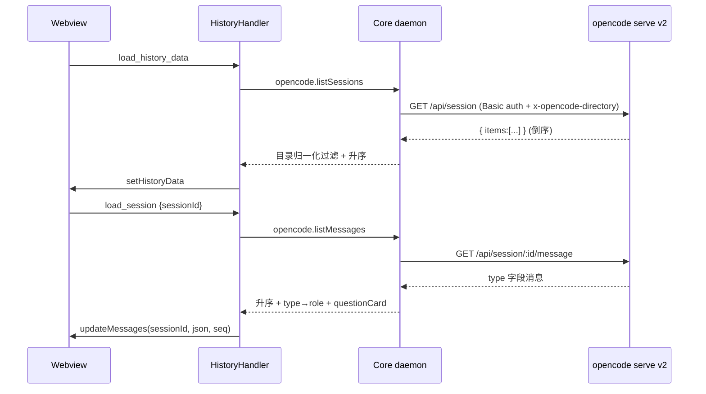
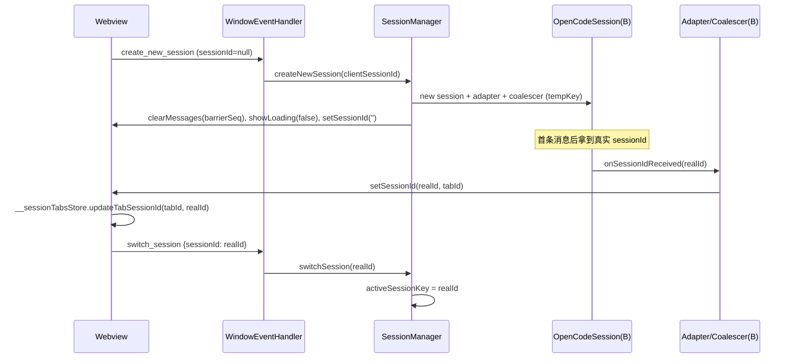
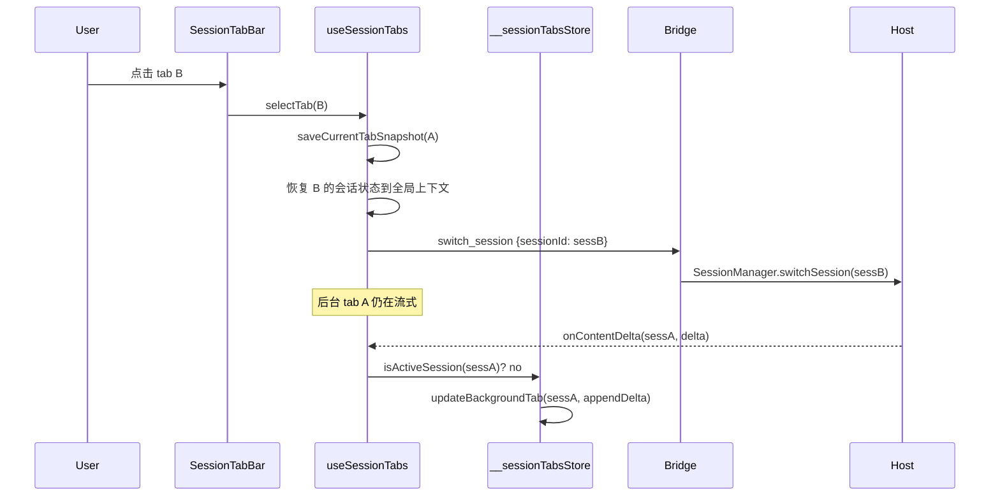
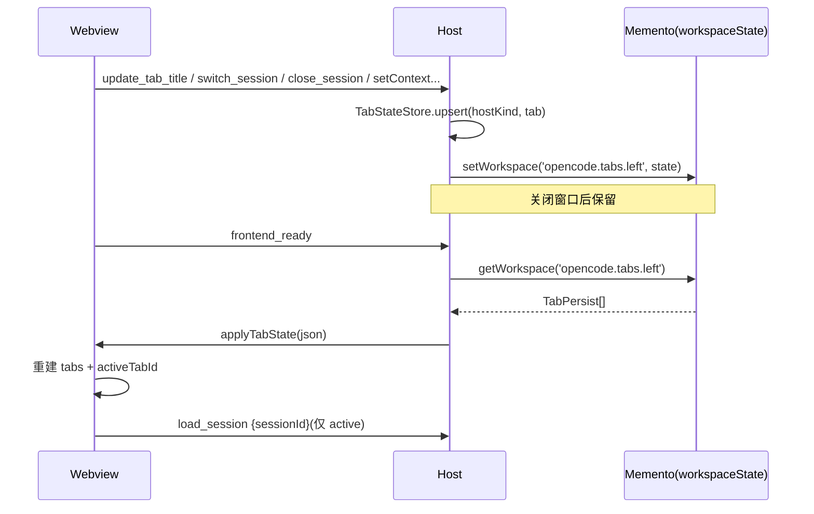

# OpenCode v2 适配 + 多标签页会话 同步方案（VS Code 插件）

> 目标仓库：`opencode-vscode-plugin`；参考实现：`opencode-idea-gui`；共享核心：`opencode-buddy-core`。
> 本文档为实施蓝本，实施时严格按阶段顺序推进，勿跳阶段。

## 0. 决策记录
- D1：多标签策略采用 **A —— 完整移植 idea 的 webview 内标签栏**（一个 webview 承载 N 个会话 tab，后台 tab 持续流式）。
- D2：core 依赖 **先基于 `opencode-buddy-core` main 最新代码开发**（本地 `pnpm run link:core`），发布前再 pin 到含 `main` 的新 tag（v0.2.0 不含修正后的 v2 请求体，不可用）。
- D3（⚠️待确认）：随多标签一并**移除 `skipNewSessionConfirm`（新建会话二次确认）**，与 idea `0c66fa7` 一致（标签即新会话）。默认按“移除”实施。

## 1. 总目标
1. 让 vscode 插件在 **OpenCode v2 服务端**（`opencode serve` v2，`/api/*`）下历史加载、发送、表单、权限、@文件、状态面板全部正常。
2. 让 vscode 插件具备 **webview 内多标签页会话**：新建/切换/关闭/重命名/拖拽排序/fork/导出；后台 tab 继续生成且不污染前台；切 tab 保留草稿与待处理弹窗。

## 2. 现状（Baseline）

| 维度 | vscode 现状 | idea 现状 |
|---|---|---|
| core 依赖 | `package.json:113` = `#v0.1.0`（v2 不可用） | `build.gradle:481` `coreVersion`（本地 sibling core = main） |
| v2 协议 | 全在 core；插件缺 `toolConstants` shell、历史 questionCard 归一化 | 已有 |
| 多标签 | 原生 `WebviewPanel`（`TabManager`），webview 单会话、无标签栏 | webview 内标签（`useSessionTabs` / `SessionTabBar`） |
| 会话回调 | 单参 `window.fn(json)` | `sessionId` 优先 `window.fn(sessionId, ...)` |
| 后台会话 | 已移除（上一轮方案 B） | tab 驱动后台流 |

> 上一轮已移除“新建会话保持旧会话执行”设置与后台保活会话。idea 的多标签**依赖后台会话**（切 tab 不中断后台流），且 multi-tab 本身**取代**了保活设置（idea `0c66fa7` 删除 `utils/skipNewSessionConfirm.ts`）。因此本方案会把后台会话以“tab 驱动”的形式重新引入。

---

## Phase 1 — OpenCode v2 适配

### 1.1 目标
v2 服务端下功能可用；修复 `docs/opencode-v2-compatibility-analysis.md` 记录的“历史 404 / 发送即报错”。

### 1.2 架构调整
- **core 承担全部 v2 REST/SSE 适配**（认证 `service.json`、`/api/info` 探活、`/api/session|prompt|command|interrupt|compact|revert|fork|permission|form|event|model|agent`、`listMessages` 升序 + `type→role`、`tool.input.started→called→success`、`shell→bash` 实时侧、`form.*→questions`）。
- 插件侧仅补 **UI / 历史转换** 的 v2 项。

### 1.3 分层修改

**Core（本地联调）**
- 使用 `opencode-buddy-core` main HEAD（`55eec03`）；vscode 执行 `pnpm run link:core`。
- 确认 `opencode.send` / `opencode.shell` 已带 `params.sessionId`（core 多会话按 session 串行队列 `daemon.js:sessionTurnQueues`）——vscode 已满足（`src/host/session/OpenCodeSession.ts`）。

**Host（`src/host`）**
- `session/SdkMessageConverter.ts`：历史消息转换补 `shell→bash` 工具名映射；question 工具块注入 `block.questionCard`（含 `metadata.answers` 还原），对齐 idea `OpenCodeMessageConverter.java:226/233/396`。
- `util/MessageJsonConverter.ts`：保留 questionCard 字段透传。

**Webview（`webview/src`）**
- `utils/toolConstants.ts:19`：`BASH_TOOL_NAMES` 加入 `'shell'`。
- `types/index.ts`：新增 `QuestionCardData`（`tool_use.questionCard`）。
- `components/MessageItem/ContentBlockRenderer.tsx`：优先渲染 `block.questionCard`，`rawQuestions` JSON 兜底。
- `components/MessageItem/QuestionAnswerSummary.tsx`：questions 归一化（string / object / array）。

**依赖**
- `package.json` / `tools/prepare-core.mjs:37`：本地阶段用 link；发布前 pin 新 tag（见 Phase 4）。

### 1.4 时序图


### 1.5 持久化
无新增（core 负责 `~/.config/opencode/service.json` 认证；会话历史缓存沿用 `SessionHistoryStore` 的 `opencode.history.sessions` globalState）。

### 1.6 验收
core `npm test`；webview `pnpm test`；宿主 `pnpm run compile` + `vscode-test`；端到端：历史列表、发送、表单弹窗、权限批准、图片、`@` 引用、状态面板。

---

## Phase 2 — 宿主多会话基础设施

### 2.1 目标
一个 `ChatInstance` 内可托管 N 个会话，每个会话独立流式与状态；所有 host→webview 回调携带 `sessionId`。

### 2.2 架构调整（分层）
```
extension.ts
  └─ OpenCodeViewProvider / TabManager   (容器层，1 webview = 1 ChatInstance)
        └─ ChatInstance
              ├─ MessageDispatcher (handlers)
              ├─ SessionRegistry (新)      ← 取代单 active
              │     └─ per-session: OpenCodeSession + SessionCallbackAdapter + StreamMessageCoalescer
              └─ HistoryHandler
```

### 2.3 分层修改

**Router / Protocol**
- `router/HandlerContext.ts`：新增会话池 `registerSession(id, session)` / `getSession(id)` / `removeSession(id)` / `setActiveSession(id)`；`getSession()` 返回 active（保持兼容）。
- `router/protocol.ts` + `webview/src/types/protocol.ts`：新增 / 扩展载荷：
  - `create_new_session { sessionId? }`、`switch_session { sessionId }`、`close_session { sessionId }`、`load_session { sessionId }`、`interrupt_session { sessionId }`、`fork_session { sessionId, type }`、`send_message { tabId, sessionId, ... }`、`refresh_editor_context { tabId, enabled }`。

**Session 层**
- `session/SessionManager.ts`：由单 active → **多会话注册表**（`Map<sessionKey, OpenCodeSession>` + `activeSessionKey`）；`createNewSession(clientSessionId?)`、`switchSession(id)`、`closeSession(id)`；**后台会话继续消费流**（不中断、不 dispose，仅不切换 active）。
- `session/OpenCodeSession.ts`：认领自己的 `sessionId`；`setCallback` 时绑定会话。
- `session/SessionCallbackAdapter.ts`：**所有 `jsTarget.callJavaScript(fn, sessionId, ...args)`** 首参注入 `sessionId`（对齐 idea `SessionCallbackAdapter.java`）。
- `session/StreamMessageCoalescer` 对应实现：`updateMessages(sessionId, json, seq)`、`onStreamingHeartbeat(sessionId)`。
- `session/SessionState.ts`：窗口基准（当前恒 0，是否启用分页留待后续，不在本阶段）。

**Handlers**
- `handlers/SessionHandler.ts`：会话解析顺序 `sessionId → tabId → activeSession`；`interrupt_session` 精准到会话（`daemon.sendAbort(sessionId, requestId)`，已支持）。
- `handlers/WindowEventHandler.ts`：新增 `switch_session` / `close_session` 分支；`create_new_session` 支持带入 `sessionId`。
- `handlers/HistoryHandler.ts`：`load_session` 走“已开则 `switchSession`，否则建新会话 + 恢复消息”；消息/状态恢复回调带 `sessionId`。
- `handlers/PermissionHandler.ts` / `ModelProviderHandler.ts` / `ContextHandler.ts`：涉及会话状态的推送带 `sessionId`。
- `handlers/TabHandler.ts` + `tabs/TabManager.ts`：`create_new_tab` 改为驱动 `window.createSessionTab`（若保留原生容器则仅作为外层）。

**Context / 持久化**
- `context/EditorContextTracker.ts`：`refresh_editor_context {tabId, enabled}` 按 tab 推送。
- `settings/SettingsService.ts`：新增 tab 状态读写键（见 Phase 4）。

### 2.4 时序图


### 2.5 持久化
本阶段仅预留接口；实际读写见 Phase 4。

### 2.6 验收
宿主单测：多会话并发流互不串流、精准 abort 隔离（扩展 `src/test/multiInstanceAndAbortIsolation.test.ts`）；`pnpm run compile`。

---

## Phase 3 — Webview 多标签 UI 与会话路由

### 3.1 目标
标签栏 UI + 会话状态模型；切 tab 不中断后台流；后台事件写入后台 tab；草稿与弹窗随 tab 保存 / 恢复。

### 3.2 架构调整
```
App.tsx
  └─ useSessionTabs (tabs[] + activeTabId + __sessionTabsStore)
        ├─ SessionTabBar / SessionTabContextMenu
        ├─ ChatScreen (常驻，切 tab 仅换状态)
        └─ useDialogManagement (__dialogStore)
```

### 3.3 分层修改

**新增**
- `hooks/useSessionTabs.ts`：API `{ tabs, activeTabId, selectTab, createTab, closeTab, renameTab, forkTab, reorderTabs, openSessionInTab, activeTabAutoOpenFileEnabled, setActiveTabAutoOpenFileEnabled }`；`SessionTabData`（含 messages / streaming / loading / pendingPermissions / pendingQuestions / draft / model / mode / effort / usage / turnStartedAt / contextInfo…）；注册 `window.__sessionTabsStore`、`window.createSessionTab`。
- `components/ChatHeader/SessionTabBar.tsx`：标签渲染、双击重命名、右键菜单、长按拖拽排序、溢出菜单、busy / attention 指示。
- `components/ChatHeader/SessionTabContextMenu.tsx`。
- `components/ChatHeader/types.ts`：`SessionTabData`。

**改造**
- `components/ChatHeader/ChatHeader.tsx`：左区换成标签栏；右区保留 新建 / 搜索 / 历史 / 设置。
- `App.tsx`：接入 `useSessionTabs`；历史列表项走 `openSessionInTab`；`sessionTitle` 变化 → `update_tab_title`。
- `main.tsx`：预注册 `window.applyBackendTabState`（早到缓存的 `__pendingBackendTabState`）。
- `global.d.ts`：新增 `__sessionTabsStore`、`__dialogStore`、`__sessionTransitionTargetSessionId`、`applyBackendTabState`；会话回调签名改 `(sessionId, …)`。
- `hooks/windowCallbacks/registerCallbacks/*`（`sessionCallbacks.ts` / `messageCallbacks.ts` / `permissionCallbacks.ts` / `streamingCallbacks.ts` / `usageModeCallbacks.ts` / `registerCallbacks.ts` / `index.ts`）：回调首参 `sessionId`；非 active 则 `updateBackgroundTab(...)` 写入后台 tab 后 `return`。
- `hooks/useDialogManagement.ts`：挂 `window.__dialogStore`（`getSnapshot` / `restore` / `clearActive`）；切 tab 保存 / 恢复 pending 权限与问题弹窗。
- `hooks/useSessionManagement.ts`：改为 tab 感知（新建 → 新 tab、加载 → tab）；移除二次确认流（D3）。
- `utils/skipNewSessionConfirm.ts`：删除（D3）；同步清理 settings UI / 文案。
- `types/index.ts`：`AskUserQuestionRequest` / `PermissionRequest` 增 `sessionId?`。
- `styles/less/components/header.less`：标签栏样式（`.session-tabs-container` / `.session-tab-item` / `.session-tab-context-menu` / 溢出菜单 / 拖拽指示等）。
- i18n 10 个 locale：`common.newTab` / `common.pendingApproval` / `chat.renameSession` / `chat.forkSession` / `chat.exportMarkdown` / `common.moreSessions` 等；删除 `settings.basic.newSessionConfirm*`。

**协议**
- `webview/src/types/protocol.ts`：与 host 同步增补（Phase 2）。

### 3.4 时序图


### 3.5 持久化
草稿（draft）随 tab 保存在内存；持久化见 Phase 4（webview localStorage 镜像 + host 权威）。

### 3.6 验收
移植 idea 测试：`ChatHeader.test.tsx`（选 tab / 新建 / 导出 / 拖拽）、`useSessionTabsContextDecoupling.test.ts`；扩展 `useSessionManagement.test.ts`；`pnpm run build`。

---

## Phase 4 — 持久化、测试、文档、回归

### 4.1 目标
重启后恢复标签页与会话绑定；补全测试与文档；端到端回归。

### 4.2 数据持久化（对齐 idea `TabStateService`）

**权威源：宿主 `MementoSettingsStore`（VS Code Memento）**
- 存储位置与键（新增）：
  - `opencode.tabs.<hostKind>`（`hostKind ∈ {left,right}`，编辑器面板实例为临时不持久化）：`{ tabs: TabPersist[], activeTabId, tabCount }`
  - `TabPersist = { tabId, isCustomTitle, title, provider, sessionId, cwd, model, permissionMode, reasoningEffort, autoOpenFileEnabled }`
  - 键按 **workspaceState**（会话绑定到项目 / cwd）；跨工作区不共享（与 idea PROJECT 级一致）。
- 写入时机（对齐 idea `persistTabSessionState` 触发点）：新建会话、切换会话、关闭会话、重命名、收到真实 sessionId、设置变更。
- 读取 / 恢复：`frontend_ready` 时读取 → `callJavaScript('applyTabState', json)` → webview 重建 tabs。恢复策略（对齐 idea `TabSessionRestorePolicy`）：仅当 tab 有 `sessionId` 才 `load_session`；**仅 active tab 立即加载**，后台 tab 首次激活时惰性加载。

**Webview 镜像（localStorage，可选，用于首屏）**
- 键 `opencode-tabs`（结构同上）；宿主 HTML 内联注入 `window.__INITIAL_TAB_STATE__`（类比 `__INITIAL_UI_PREFERENCES__`）避免闪烁；随后 `applyTabState` 权威覆盖。

**新增宿主模块**
- `src/host/session/TabStateStore.ts`：`getTabs(hostKind)` / `setTabs(hostKind, state)` / `removeTab(...)` / 索引重排（对齐 `TabStateService.onTabRemoved`）。
- `SettingsService` 增对应读写封装。

**持久化时序图**


### 4.3 测试
- 宿主：tab 持久化读写 / 索引重排；多会话路由；精准中断隔离。
- Webview：`useSessionTabs` 切换 / 关闭 / 重命名 / fork / 拖拽；后台路由；`applyTabState` 恢复；`__dialogStore` 保存恢复。
- 全量：`pnpm run compile`（宿主）、`pnpm run build` + `pnpm test`（webview）、`vscode-test`。

### 4.4 文档
- 更新 `docs/multi-tab-and-session-isolation.md` 为“webview 内标签”架构；新增本方案落地的 `docs/multi-tab-implementation.md`（时序 / 协议 / 持久化）。

### 4.5 发布
- `package.json:113` pin 到含 core main 的新 tag；`tools/prepare-core.mjs:37` 同步；`pnpm run unlink:core` 后打包验证。

---

## 5. 风险与回滚
- 协议一一对应易漏：以 idea `global.d.ts` 回调清单为 checklist 逐项核对。
- 与上一轮“移除后台保活”方向反转：后台会话以 tab 形式重建，勿再引入 `keepPreviousSessionRunning` 设置（多标签取代之）。
- core pin 必须是含 `55eec03` 的 tag，否则 v2 仍不可用。
- 每阶段可独立回滚（Phase 1 独立；Phase 2 / 3 需一起回滚）。

## 6. 实施顺序
Phase 1 → Phase 2 → Phase 3 → Phase 4（严格顺序）。
